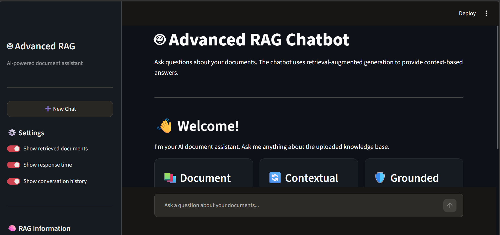
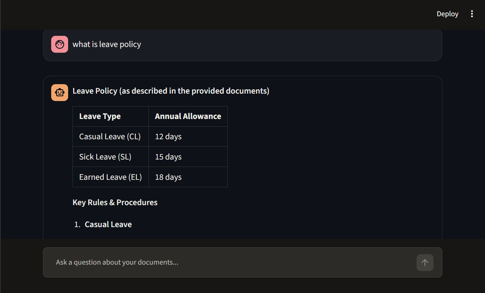

# Advanced Conversational RAG Chatbot

An Advanced Retrieval-Augmented Generation (RAG) chatbot built using Python, LangChain, FAISS, Hugging Face embeddings, Groq LLM, FastAPI, and Streamlit.

The chatbot answers questions using retrieved document context, supports conversational follow-ups, classifies user intent, and maintains conversation history.

## Features

- **Document Question Answering:** Retrieves relevant information from PDF documents.
- **Conversational Memory:** Maintains chat history for contextual conversations.
- **Intent Classification:** Routes queries into Document, History, and General conversation categories.
- **Contextual Question Rewriting:** Converts follow-up questions into standalone questions.
- **Vector Search:** Uses FAISS for semantic similarity retrieval.
- **Embeddings:** Uses the `sentence-transformers/all-MiniLM-L6-v2` embedding model.
- **LLM:** Uses Groq for language model inference.
- **FastAPI Backend:** Exposes the chatbot through REST API endpoints.
- **Streamlit Frontend:** Provides an interactive chatbot interface.
- **Grounded Responses:** Document answers are instructed to use retrieved context and avoid unsupported information.

## Project Architecture

```text
User
 │
 ▼
Streamlit Frontend (ui.py)
 │
 ▼
FastAPI Backend (api.py)
 │
 ▼
RAG Pipeline
 │
 ├── Intent Classification
 │
 ├── Contextual Question Rewriting
 │
 ├── FAISS Retriever
 │
 ├── Document Answer Chain
 │
 ├── History Answer Chain
 │
 └── General Conversation Chain
 │
 ▼
Groq LLM
```


## Technologies Used

- Python
- LangChain
- FAISS
- Hugging Face Sentence Transformers
- Groq
- FastAPI
- Streamlit
- PyPDF

## Screenshots

### Chatbot Interface



### Document Question Answering




## Installation

### 1. Clone the repository

```bash
git clone https://github.com/YOUR_USERNAME/ADV_RAG.git
cd ADV_RAG
```

### 2. Create a virtual environment

```bash
python -m venv venv
```

Activate it on Windows:

```bash
venv\Scripts\activate
```

### 3. Install dependencies

```bash
pip install -r requirements.txt
```

### 4. Configure environment variables

Create a `.env` file in the root directory:

```env
GROQ_API_KEY=your_groq_api_key
```

Replace the placeholder with your own API key.

**Never commit your `.env` file or API keys to GitHub.**

### 5. Prepare the vector database

If the vector database is not included, place the authorized PDF document in the `data/` directory and run:

```bash
python ingest.py
```

This creates the FAISS vector database.

## Running the Application

### Start the FastAPI backend

Open a terminal:

```bash
python -m uvicorn api:app --reload
```

API:

```text
http://127.0.0.1:8000
```

Interactive API documentation:

```text
http://127.0.0.1:8000/docs
```

### Start the Streamlit frontend

Open another terminal:

```bash
python -m streamlit run ui.py
```

Frontend:

```text
http://localhost:8501
```

## API Endpoints

| Method | Endpoint | Description |
|---|---|---|
| GET | `/` | API welcome message |
| GET | `/health` | Health check |
| POST | `/chat` | Submit a question |
| DELETE | `/clear-history/{session_id}` | Clear session history |

### Chat API Example

Request:

```json
{
  "session_id": "user_001",
  "question": "What is the company leave policy?"
}
```

## RAG Workflow

1. Receive the user's question.
2. Identify the query intent.
3. Rewrite contextual questions when necessary.
4. Retrieve relevant document chunks using FAISS.
5. Generate a context-grounded response using Groq.
6. Maintain conversation history.
7. Return the response to the user.

## Future Improvements

- Document upload through the frontend
- Support for multiple PDF documents
- Improved source citations
- Persistent conversation history
- Authentication and user-specific sessions
- Advanced retrieval techniques
- Deployment

## Author

**Dinesh**

---

If you find this project useful, feel free to explore the repository.
